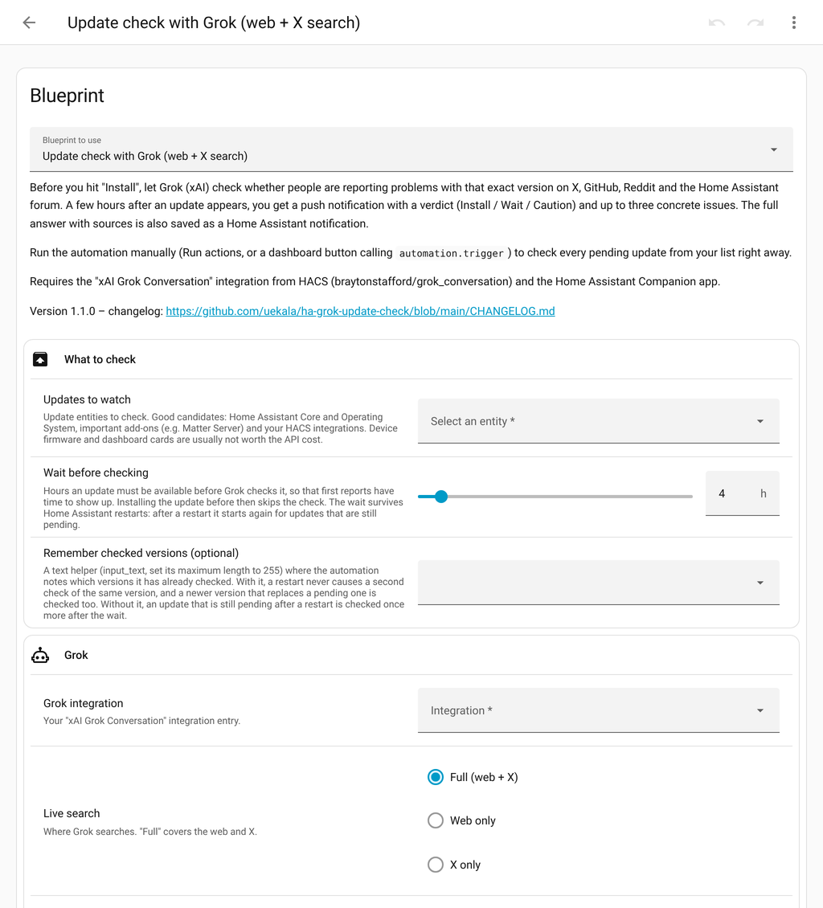

# Update-Check mit Grok für Home Assistant

Kann man das Update schon installieren? Dieser Blueprint lässt **Grok (xAI)** auf **X, GitHub, Reddit und im Home-Assistant-Forum** nach Problemen mit genau der Version suchen, die gerade aufgetaucht ist, und schickt dir das Ergebnis, bevor du auf *Installieren* tippst.

```
Update: Home Assistant Core 2026.11.1
Recommendation: Wait
- Several users report Matter devices unavailable after the update.
- Fix is already merged for 2026.11.2.
```

[](https://my.home-assistant.io/redirect/blueprint_import/?blueprint_url=https%3A%2F%2Fgithub.com%2Fuekala%2Fha-grok-update-check%2Fblob%2Fmain%2Fblueprints%2Fautomation%2Fgrok_update_check.yaml)



<sub>Eine Automation aus dem Blueprint anlegen (Home Assistant 2026.11).</sub>

## So funktioniert es

1. Eine beobachtete Update-Entität springt auf *Update verfügbar*.
2. Nach einer einstellbaren Wartezeit (Standard 4 Stunden, damit erste Berichte auftauchen können) startet Grok eine Live-Suche zu dieser Version. Die Automation sucht alle 15 Minuten nach fälligen Updates, die Prüfung läuft also höchstens 15 Minuten nach Ablauf der Wartezeit.
3. Du bekommst eine Push-Nachricht: **Install / Wait / Caution** (installieren, warten, Vorsicht) und bis zu drei konkrete Probleme. Ein Tipp darauf öffnet die Update-Seite.
4. Die vollständige Antwort mit Quellen wird als Benachrichtigung in Home Assistant gespeichert.

Startest du die Automation von Hand, prüft sie sofort **alle offenen Updates** aus deiner Liste (siehe [Knopf fürs Dashboard](#knopf-fürs-dashboard)).

## Voraussetzungen

- Home Assistant **2026.7** oder neuer
- [xAI Grok Conversation](https://github.com/braytonstafford/grok_conversation) aus HACS, eingerichtet mit einem xAI-API-Schlüssel mit Guthaben
- Home-Assistant-Companion-App auf dem Handy

## Einrichtung

1. Den Blueprint mit dem Knopf oben importieren.
2. Eine Automation daraus anlegen und die Eingaben ausfüllen (die Namen stehen im Editor auf Englisch):

| Eingabe | Wozu |
|---|---|
| Updates to watch | Update-Entitäten, die geprüft werden. Am besten passen Core, OS, wichtige Add-ons und HACS-Integrationen. Geräte-Firmware und Dashboard-Karten lieber weglassen. |
| Wait before checking | Stunden, die ein Update verfügbar sein muss, bevor geprüft wird (0–48, Standard 4). |
| Remember checked versions (optional) | Ein Text-Helfer (Einstellungen → Geräte & Dienste → Helfer → Text, maximale Länge 255). Verhindert nach einem Neustart eine zweite Prüfung derselben Version und prüft auch eine neuere Version, die eine noch offene ersetzt. |
| Grok integration | Dein Eintrag von xAI Grok Conversation. |
| Live search | Vollständig (Web und X), nur Web oder nur X. |
| Your setup | Optionale Beschreibung (z. B. „HA Green, Zigbee über ZHA, Matter über Thread“), damit Grok sich auf das konzentriert, was bei dir zählt. |
| Answer language | z. B. English, German, Español. |
| Phone | Gerät mit der Companion-App. |
| Also save as notification | Behält die vollständige Antwort mit Quellen in Home Assistant. |
| Texts (eingeklappt) | Die beiden festen Meldungen („nichts offen“, „Prüfung fehlgeschlagen“), damit du sie übersetzen kannst. |

### Knopf fürs Dashboard

Eine Kachel, die per Tipp alle offenen Updates prüft:

```yaml
type: tile
entity: automation.update_check_with_grok   # Entitäts-ID deiner Automation
name: Grok-Update-Check
icon: mdi:update
tap_action:
  action: perform-action
  perform_action: automation.trigger
  target:
    entity_id: automation.update_check_with_grok
  data:
    skip_condition: true
  confirmation:
    text: Grok-Update-Check für alle offenen Updates starten?
```

## Gut zu wissen

- **Kosten:** Jede Prüfung nutzt die Live-Suche. Im Test brauchte eine Prüfung etwa 20.000 Prompt-Tokens. Der Sensor `estimated_cost` der Integration zeigt, was du tatsächlich ausgibst.
- **Datenschutz:** An xAI gehen der Name der Komponente, beide Versionsnummern, der Link zu den Release-Notes und deine optionale Beschreibung. Keine Zustände von Entitäten.
- **Zeitpunkt:** Installierst du das Update vor Ablauf der Wartezeit, entfällt die Prüfung. Ein Neustart von Home Assistant während der Wartezeit lässt sie nicht ausfallen: Für Updates, die noch offen sind, beginnt die Wartezeit von vorn. Ohne den optionalen Text-Helfer wird ein Update, das nach einem Neustart noch offen ist, nach der Wartezeit ein weiteres Mal geprüft.
- **Bekannter Fehler in der Integration (v1.11.1):** Mit eingeschaltetem *Send user name* schlagen Anfragen von Nutzern ohne verknüpfte Person fehl. Die Option ausschalten, bis der Fehler in der Integration behoben ist.
- Grok kann sich irren. Nimm die Einschätzung als Hinweis und lies bei allem Wichtigen die Release-Notes.

## Entwicklung

```bash
pip install -r requirements_test.txt
pytest -q
```

`tests/test_blueprint.py` prüft den Aufbau nur mit PyYAML. `tests/test_runtime.py` lädt den Blueprint mit dem Blueprint-Code von Home Assistant selbst und führt ihn in einer Testinstanz aus: Wartezeit, Neustart, Gedächtnis, Start von Hand und Fehlertext. Nur der Grok-Dienst und die Handy-Benachrichtigung werden durch aufzeichnende Attrappen ersetzt.

Änderungen stehen im [Changelog](CHANGELOG.md).

## Lizenz

[MIT](LICENSE). Inoffiziell; keine Verbindung zu xAI oder Home Assistant.
